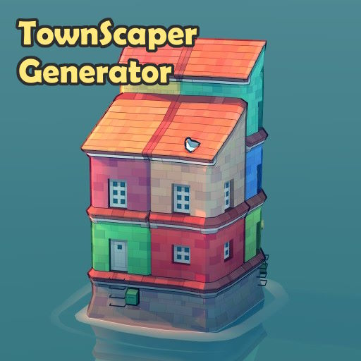

# TownScraper Generator

A procedural town generator for [Townscaper](https://store.steampowered.com/app/1291340/Townscaper/). The script generates traditional European-style towns with streets, neighborhoods, and buildings that respect the game's unique grid system.



## Features

- Coherent street network generation
- Historic and residential areas
- Landmarks placement (taller buildings)
- Thematic color palettes (terracotta, pastel, nature, mediterranean...)
- Random parameters for town variety
- Export to game-compatible `.scape` format

## Installation

1. Clone the repository:
```bash
git clone [REPO_URL]
cd townscaper-generator
```

2. Create and activate a virtual environment:
```bash
python -m venv .venv
source .venv/bin/activate  # On Linux/Mac
# or
.venv\Scripts\activate  # On Windows
```

3. Install dependencies:
```bash
pip install -r requirements.txt
```

## Usage / Configuration

1. Ensure `bases/map.json` file is present (contains an example game's base grid)
2. Run the script:
```bash
python generate.py
```

The generated file will be placed in the `towns/` default folder, or the folder specified in the `GAME_PATH` environment variable: the script uses a `.env` file to define GAME_PATH. See `dev.env` file for example.

## Generation Parameters

The town generation uses some parameters that affect the final result:

- `max_height`: Maximum building height. Higher values create more urban-looking areas.
- `street_density`: How compact the street grid is. Lower values create more spread-out towns.
- `landmark_freq`: Probability of creating taller landmark buildings. Higher values create more skylines.
- `town_size`: Controls the town radius. Limited by the base map size.
- Color palettes: Pre-defined sets of colors for different town themes (terracotta, pastel, nature, etc.)

Each parameter used for a specific generation is visible in the terminal once the script has been completed.

## Development

This script, including this README, was co-created with [Claude.ai](https://claude.ai/). AI is a great tool for cooperating as a developer - but it's important to always mention this collaboration explicitly and transparently.